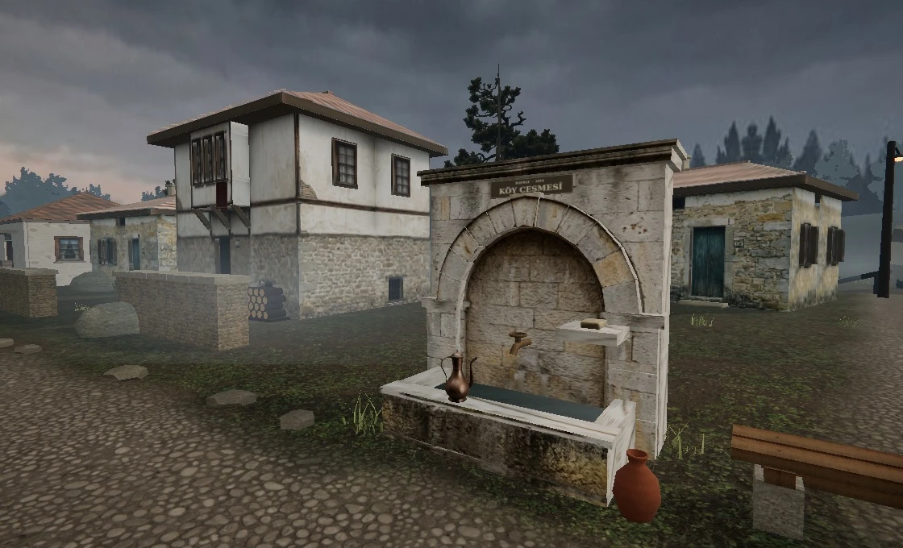
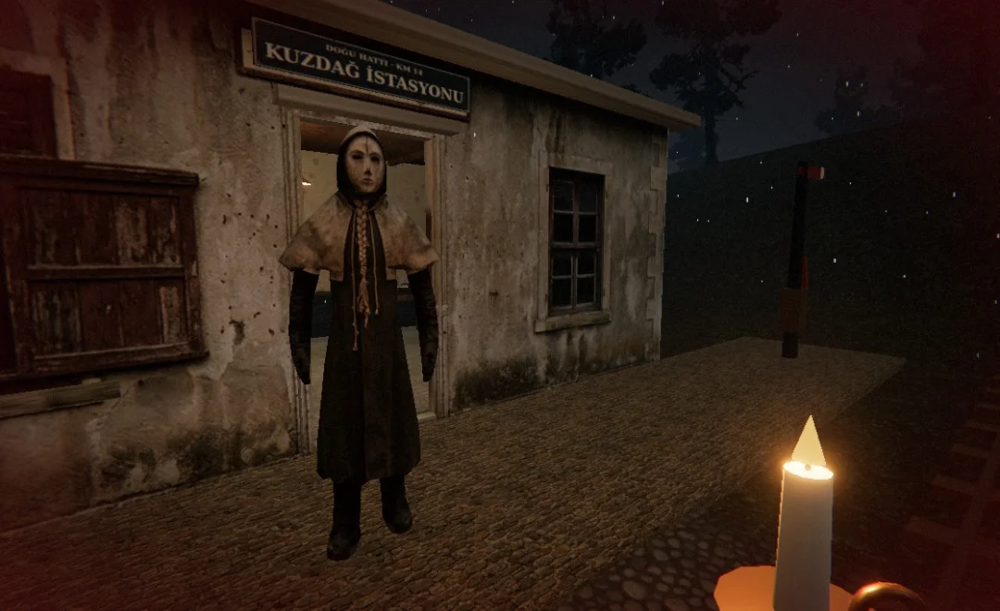

# Son Vazife

**Kuzdağ Köyü, Kasım 1993.** Yeni gassalın ilk işi sıradan bir teslim fişini deftere geçirmek. Sorun, aynı kişinin aynı haneden yirmi yıl önce de uğurlanmış olması.

Türkçe, tek oyunculu bir tarayıcı korku oyunu. Önsöz ve sekiz bölüm boyunca Kuzdağ’ın sırlarını araştırırsın. Köy ve olaylar kurmacadır.



## Oynamak

- **Oyuna başla** ile ilk nöbete gir. Fişi eski kayıtlarla karşılaştır; telefon çalınca vereceğin karşılık sana kalmış. Önsöz atlanabilir.
- **Meydana çık** üç boyutlu keşfi başlatır. Bulduğun kayıt defterine taşınır ve Bekçi Hasan’la yeni bir konuşma seçeneği açar.
- Gasilhanede, sağlık ocağında ve taş mahzende **teslim dosyaları** var. Belgeleri karşılaştırıp iki alanı doğru doldurarak dosyayı mühürleyebilirsin. Adli inceleme tezgâhı alternatif bir yoldur; hikâyede ilerlemek için onu kullanmak gerekmez.
- Meydanı, değirmeni, mezarlığı ve virajı araştır; malzemeleri topla ve gasilhaneye dön. Köyün gerçekleri tanıklar, eşyalar ve çelişkili tutanaklarda saklı.
- **Kefenin son düğümü oyunun sonu değil.** Nakil sedyesine bağlanmış etiket seni Sarı Mektep’e götürür. Yoklamayı, istasyon cetvelini ve santral hattını çöz; ardından aile yoklamasını, mezarlık kaydını ve ikinci bandı, çocuk çizimini ve santral kesinti kaydını karşılaştırıp gasilhanede son çağrıyı yanıtla. Her yeni kayıt bir devam noktasıdır; işaretleri duyamıyorsan yazılı ipuçları da yeterlidir.
- **Köy arşivi** menüde dört fotoğraf ve kenar notu içerir. Oyun içindeki **defter** ise topladığın kanıtları, haritayı ve kendi notlarını tutar.

**Kontroller:** WASD ile yürü, fareyle bak, E ile etkileşime gir. Shift koşu, C eğilme, F mum, Tab defter/harita, M ses ve Esc duraklatmadır. Fare kilidi yoksa basılı tutup sürükle. Dokunmatikte sol hareket pedi ve sağ bakış alanı kullanılır.

Önsöz, köy ilerlemesi ve tercihler bu tarayıcıda saklanır. **Devam et** son kaydı açar. Menü ve önsöz WebGL gerektirmez; üç boyutlu keşif WebGL 2 gerektirir. Sesler Web Audio ile ilk kullanıcı etkileşiminden sonra üretilir.

Köydeki 22 sıradan hane ile iki hikâye evinde aileler bulunur. Kapıların çoğu **E** ile açılır; hikâye için kilitli kapılar gerekli aşamada veya anahtarla açılır. Aile üyeleriyle **E** tuşuyla konuşabilir, ilerleyen bölümlerde değişen tanıklıklarını dinleyebilirsin. Aileler çeşitlendirilmiş mevcut sakin modellerini ve kısa ortak tanıklıkları paylaşır; birbirinden bağımsız uzun diyalog ağaçları değildir.

## Hayatta kalma ve kaçış

Köyde geçirdiğin her **10 dakikalık aktif oyun simülasyonu** bir hayatta kalma günü sayılır. Defter, diyalog ve duraklatma sırasında sayaç ilerlemez. Kara Basma ve Sis Gözcüsü üç kez yakalarsa gece sona erer; ilk iki karşılaşma kaydedilir. Son telefonu yanıtladıktan sonra defter haritasında işaretlenen **istasyon peronuna** yürüyerek köyden çıkabilirsin. Her günün ilk beş dakikası gündüz, ikinci beş dakikası akşamdır; ışık ve sis buna göre değişir. İlk korku görüntüsü yaklaşık 35 saniye aktif keşiften sonra ortaya çıkar; ilerleyen bölümlerde ve akşamları karşılaşmalar sıklaşır. Mum yağı dışında yeni bir kaynak sistemi yoktur.

### Mektep yolu ve son peron

Kuzdağ’ın haritası sekiz bölgeyi gösterir. Sağlık ocağından mektebe çıkabilir, doğu yolundan istasyona inebilir veya dereyi geçip santral sırtına ulaşabilirsin. Bu üç binaya girilir; aralarındaki on yeni hane ise sokakları oluşturur. Oynanabilir haritanın sınırları **85 × 88 m’den 148 × 140 m’ye** genişledi.

Geceleri Kara Basma ve Sis Gözcüsü yollarda devriye gezer. Açıkta görünürsen peşine düşerler; kapalı bir odaya sığınabilir veya mumunu söndürüp eğilebilirsin. [Peron Şefi](docs/peron-sefi.webp) ise kovalamaz: işaret kolunu ve son anonsu bekler. Merak edersen yanına gidip **E** ile dinle.



### Düşük sistemde oynamak

**Ayarlar → Görüntü kalitesi → Asgari** seçip köye gir. Zayıf cihazlarda Otomatik de bu profili seçebilir. Yakındaki evler ve eşyalar üç boyutlu, tanıklar animasyonludur; kazanç uzak ayrıntılardan, daha küçük dokulardan ve daha az çizimden gelir. Yüksek çözünürlüklü paket Asgari oturumda indirilmez. [Ölçümler, test cihazı ve sınırlar](docs/performans.md). [Güvenlik incelemesi ve açık kalan bağımlılık bildirimi](docs/guvenlik.md).

## Çalıştırmak

```sh
bun install --frozen-lockfile
bun run dev
```

Node.js 22.12+ ile `npm install` ve `npm run dev` de kullanılabilir. Vite 3000 portunda açılır. Sunucu hesabı, harici font servisi veya API anahtarı gerekmez.

```sh
npm test        # Kayıt, bulmaca, devriye, harita, etkileşim ve model testleri
npm run lint    # TypeScript denetimi
npm run build   # Üretim çıktısı: dist/
```

## Varlıklar

`public/assets/archive/` altındaki sahne ve arşiv görselleri oyun için üretilmiştir. Yazı tipleri Türkçe karakterleri içeren yerel alt kümelerdir; lisansları `public/fonts/licenses/` içindedir. Cenazeler, hazırlık peştemalı, gece figürleri ve istasyon eşyaları `public/assets/night/` içindeki tam/küçük modelleri kullanır. [Gasilhanedeki iki nakil sedyesi](docs/nakil-sedyeleri.webp) teslimler ilerledikçe dolar; önceki masalarda birer kopya kalmaz.

Atölyedeki kaynaklar menüde indirilmez: oyun `public/assets/workshop/` içindeki hazır modelleri ve `public/assets/village/` içindeki işlenmiş yüzeyleri kullanır.

Cumbalı, hımış ve taş haneler; kemerli hayrat çeşmesi, gasilhane girişi, tahta sandıklar, işlemeli bakır ibrik, ciltli defter, bağlı kefen ve sabun oyun dünyasının parçalarıdır. [Bekçi Hasan'la meydanda](docs/kuzdag-meydani.webp) karşılaşabilirsin; Şerife Nine, Katip Kenan ve Mezarcı İdris'in de ayrı iskeleti, kıyafeti ve eşyası vardır. Model kaynakları ve yeniden üretim için [Kuzdağ atölyesi](art/README.md).
